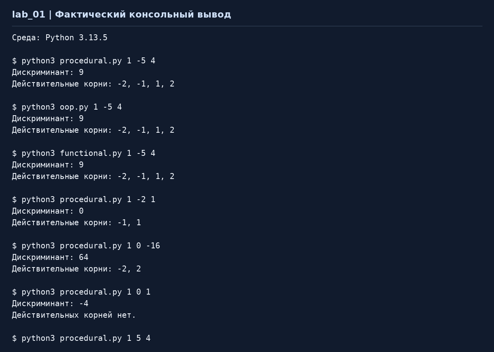
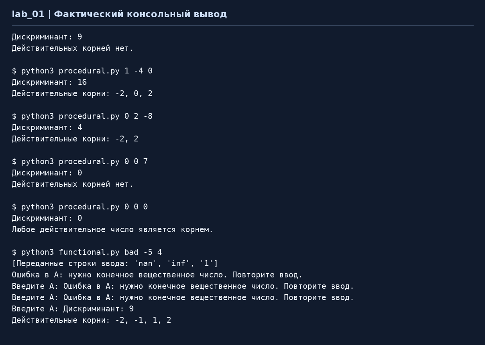
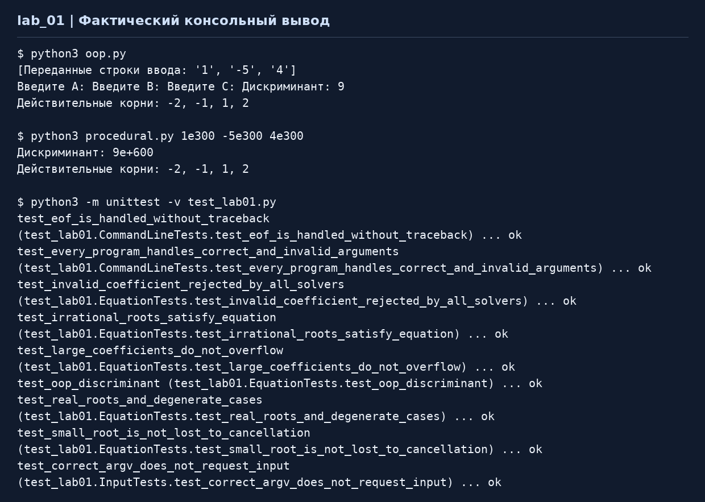
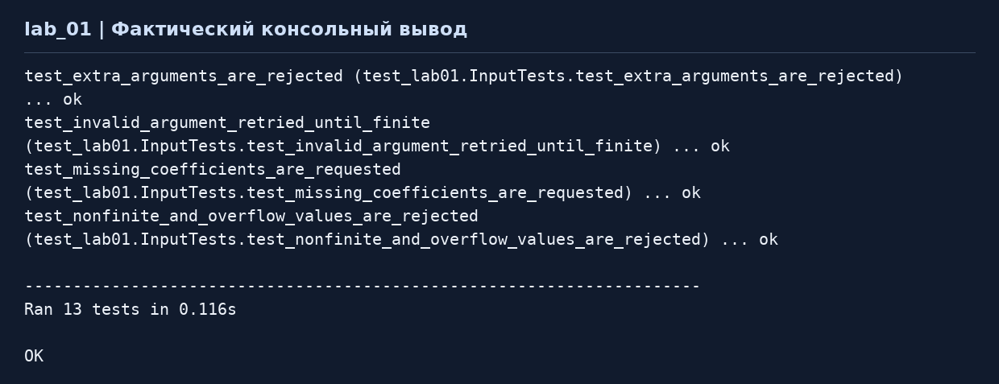

# Отчёт по лабораторной работе №1

МГТУ им. Н. Э. Баумана  
Кафедра ИУ5 «Системы обработки информации и управления»  
Дисциплина: «Парадигмы и конструкции языков программирования»

**Тема:** Основные конструкции языка Python. Решение биквадратного уравнения в трёх парадигмах.

**Выполнил:** Рулев К. А.  
**Группа:** ИУ5-35Б  
**Москва, 2026**

## 1. Цель работы

Изучить основные конструкции Python и сопоставить процедурный,
объектно-ориентированный и функциональный подходы на одной вычислительной задаче.

## 2. Задание

Официальное условие: https://github.com/ugapanyuk/BKIT_2022/wiki/lab_python_intro

Разработать три консольные программы решения уравнения
`A*x^4 + B*x^2 + C = 0`: с функциями, с классами и с сопоставлением с образцом.
Вводить коэффициенты через аргументы командной строки или с клавиатуры.
Ошибочно заданный коэффициент запрашивать повторно до корректного ввода.
Вычислять дискриминант и все действительные корни. В отчёте представить код
и примеры выполнения.

Дополнительно обработаны вырожденные случаи, повторные корни, `NaN`,
бесконечность, конец ввода и большое значение коэффициентов.

## 3. Алгоритм

Выполняется замена `t = x²`, после которой получается квадратное уравнение
`A*t² + B*t + C = 0`.

1. Проверить конечность каждого коэффициента. Для промежуточной арифметики
   использовать `Decimal` и 50 значащих цифр.
2. Если `A = 0` и `B != 0`, решить `t = -C/B`.
3. Если `A = B = 0`, при `C = 0` любое действительное число является решением,
   иначе решений нет.
4. Для `A != 0` вычислить `D = B² - 4*A*C`.
5. При `D < 0` решений нет. При `D = 0` получить `t = -B/(2*A)`.
6. При `D > 0` использовать устойчивую форму квадратной формулы:
   `q = -(B + sign(B)*sqrt(D))/2`, где при `B = 0` берётся знак `+1`;
   затем `t1 = q/A`, `t2 = C/q`. Это уменьшает потерю малого корня при
   вычитании близких чисел.
7. Каждое положительное `t` даёт два корня `±sqrt(t)`, нулевое `t` даёт
   единственный корень `0`, отрицательное `t` не даёт действительных корней.
8. Удалить повторы, отсортировать корни и вывести результат.

Внутреннее представление решения: кортеж корней; пустой кортеж означает
отсутствие корней, `None` означает тождество. Вывод ограничен 12 значащими
цифрами. Используемая арифметика численная, поэтому иррациональные корни
представляются приближённо.

## 4. Реализация трёх подходов

**Процедурный подход:** функция `solve` получает три коэффициента, проверяет
условия и возвращает решение. Последовательность шагов выражена через `if`.

**Объектно-ориентированный подход:** объект `BiquadraticEquation` хранит
коэффициенты. Вычисляемое свойство `discriminant` и метод `solve` объединяют
данные с операциями над ними. Функция-адаптер связывает класс с общим интерфейсом
консольного запуска.

**Функциональный подход:** функция не изменяет переданные данные и возвращает
одинаковый результат при одинаковых аргументах. Конструкции `match` выбирают
вырожденные случаи и ветви по знаку дискриминанта. Ввод и вывод вынесены за
границы решающей функции.

Модуль `common.py` содержит только общие операции: получение коэффициентов,
преобразование неотрицательных квадратов в корни, форматирование и запуск.
Само решение квадратного уравнения явно реализовано каждым из трёх подходов.
Программы используют только стандартную библиотеку Python 3.10+.

## 5. Исходный код

### common.py

```python
"""Общий ввод, вывод и преобразование t = x² обратно к x."""

from decimal import Decimal, localcontext
import math
import sys


PRECISION = 50


def coefficient(value):
    """Проверить конечное вещественное число и сохранить его десятичную запись."""
    try:
        number = float(value)
        if not math.isfinite(number):
            raise ValueError
        return Decimal(str(number))
    except (ValueError, TypeError, OverflowError):
        raise ValueError("нужно конечное вещественное число") from None


def read_coefficients(argv=None, input_fn=None, output_fn=None):
    """Ошибочный или отсутствующий аргумент заменяется интерактивным вводом."""
    args = list(sys.argv[1:] if argv is None else argv)
    input_fn = input if input_fn is None else input_fn
    output_fn = print if output_fn is None else output_fn
    if len(args) > 3:
        raise ValueError("ожидается не более трёх коэффициентов A B C")
    result = []
    for index, name in enumerate(("A", "B", "C")):
        value = args[index] if index < len(args) else None
        while True:
            if value is None:
                value = input_fn(f"Введите {name}: ")
            try:
                result.append(coefficient(value))
                break
            except ValueError as error:
                output_fn(f"Ошибка в {name}: {error}. Повторите ввод.")
                value = None
    return tuple(result)


def roots_from_squares(values):
    """Отрицательные t отбрасываются; повторные корни и -0 удаляются."""
    roots = set()
    for value in values:
        if value > 0:
            root = value.sqrt()
            roots.update((-root, root))
        elif value == 0:
            roots.add(Decimal(0))
    return tuple(sorted(roots))


def format_number(value):
    return "0" if value == 0 else format(value.normalize(), ".12g")


def run(solver, argv=None):
    try:
        a, b, c = read_coefficients(argv)
        with localcontext() as context:
            context.prec = PRECISION
            discriminant = b * b - 4 * a * c
            roots = solver(a, b, c)
            print(f"Дискриминант: {format_number(discriminant)}")
            if roots is None:
                print("Любое действительное число является корнем.")
            elif roots:
                print("Действительные корни: " + ", ".join(map(format_number, roots)))
            else:
                print("Действительных корней нет.")
        return 0
    except (EOFError, KeyboardInterrupt):
        print("\nВвод прерван.", file=sys.stderr)
        return 1
    except ValueError as error:
        print(f"Ошибка: {error}.", file=sys.stderr)
        return 2
```

### procedural.py

```python
"""Биквадратное уравнение: процедурный подход."""

from decimal import localcontext
from common import PRECISION, coefficient, roots_from_squares, run


def solve(a, b, c):
    a, b, c = map(coefficient, (a, b, c))
    with localcontext() as context:
        context.prec = PRECISION
        if a == 0:
            if b == 0:
                return None if c == 0 else ()
            return roots_from_squares((-c / b,))

        discriminant = b * b - 4 * a * c
        if discriminant < 0:
            return ()
        if discriminant == 0:
            return roots_from_squares((-b / (2 * a),))

        # Устойчивая форма квадратной формулы уменьшает потерю точности.
        sqrt_d = discriminant.sqrt()
        q = -(b + (sqrt_d if b >= 0 else -sqrt_d)) / 2
        return roots_from_squares((q / a, c / q))


if __name__ == "__main__":
    raise SystemExit(run(solve))
```

### oop.py

```python
"""Биквадратное уравнение: объектно-ориентированный подход."""

from decimal import localcontext
from common import PRECISION, coefficient, roots_from_squares, run


class BiquadraticEquation:
    def __init__(self, a, b, c):
        self.a, self.b, self.c = map(coefficient, (a, b, c))

    @property
    def discriminant(self):
        with localcontext() as context:
            context.prec = PRECISION
            return self.b * self.b - 4 * self.a * self.c

    def solve(self):
        with localcontext() as context:
            context.prec = PRECISION
            if self.a == 0:
                if self.b == 0:
                    return None if self.c == 0 else ()
                return roots_from_squares((-self.c / self.b,))

            discriminant = self.discriminant
            if discriminant < 0:
                return ()
            if discriminant == 0:
                return roots_from_squares((-self.b / (2 * self.a),))

            sqrt_d = discriminant.sqrt()
            q = -(self.b + (sqrt_d if self.b >= 0 else -sqrt_d)) / 2
            return roots_from_squares((q / self.a, self.c / q))


def solve(a, b, c):
    return BiquadraticEquation(a, b, c).solve()


if __name__ == "__main__":
    raise SystemExit(run(solve))
```

### functional.py

```python
"""Биквадратное уравнение: чистая функция с сопоставлением с образцом."""

from decimal import localcontext
from common import PRECISION, coefficient, roots_from_squares, run


def solve(a, b, c):
    a, b, c = map(coefficient, (a, b, c))
    with localcontext() as context:
        context.prec = PRECISION
        match (a, b, c):
            case (0, 0, 0):
                return None
            case (0, 0, _):
                return ()
            case (0, _, _):
                return roots_from_squares((-c / b,))
            case _:
                discriminant = b * b - 4 * a * c
                match discriminant:
                    case d if d < 0:
                        return ()
                    case 0:
                        return roots_from_squares((-b / (2 * a),))
                    case d:
                        sqrt_d = d.sqrt()
                        q = -(b + (sqrt_d if b >= 0 else -sqrt_d)) / 2
                        return roots_from_squares((q / a, c / q))


if __name__ == "__main__":
    raise SystemExit(run(solve))
```

### test_lab01.py

```python
"""Проверки математических случаев, ввода и консольных программ."""

from decimal import Decimal
from pathlib import Path
import subprocess
import sys
import unittest

import functional
import oop
import procedural
from common import coefficient, read_coefficients


SOLVERS = (procedural.solve, oop.solve, functional.solve)
ROOT = Path(__file__).resolve().parent


class EquationTests(unittest.TestCase):
    def test_real_roots_and_degenerate_cases(self):
        cases = [
            ((1, -5, 4), (-2, -1, 1, 2)),
            ((1, -2, 1), (-1, 1)),
            ((1, 0, -16), (-2, 2)),
            ((1, 0, 1), ()),
            ((1, 5, 4), ()),
            ((1, 2, 1), ()),
            ((1, -4, 0), (-2, 0, 2)),
            ((1, 0, 0), (0,)),
            ((0, 2, -8), (-2, 2)),
            ((0, -2, 8), (-2, 2)),
            ((0, 2, 8), ()),
            ((0, 2, 0), (0,)),
            ((0, 0, 7), ()),
            ((0, 0, 0), None),
            ((-1, 5, -4), (-2, -1, 1, 2)),
        ]
        for solver in SOLVERS:
            for coefficients, expected in cases:
                with self.subTest(solver=solver.__module__, coefficients=coefficients):
                    self.assertEqual(solver(*coefficients), expected)

    def test_irrational_roots_satisfy_equation(self):
        for solver in SOLVERS:
            with self.subTest(solver=solver.__module__):
                roots = solver(1, -3, 2)
                self.assertEqual(len(roots), 4)
                for root in roots:
                    self.assertLess(abs(root ** 4 - 3 * root ** 2 + 2), Decimal("1e-24"))

    def test_large_coefficients_do_not_overflow(self):
        for solver in SOLVERS:
            with self.subTest(solver=solver.__module__):
                self.assertEqual(solver(1e300, -5e300, 4e300), (-2, -1, 1, 2))

    def test_small_root_is_not_lost_to_cancellation(self):
        for solver in SOLVERS:
            with self.subTest(solver=solver.__module__):
                roots = solver(1, -1e100, 1)
                self.assertEqual(len(roots), 4)
                self.assertGreater(roots[2], 0)
                self.assertLess(abs(roots[2] - Decimal("1e-50")), Decimal("1e-75"))

    def test_invalid_coefficient_rejected_by_all_solvers(self):
        for solver in SOLVERS:
            for value in (float("nan"), float("inf"), "oops"):
                with self.subTest(solver=solver.__module__, value=value):
                    with self.assertRaises(ValueError):
                        solver(value, 1, 1)

    def test_oop_discriminant(self):
        self.assertEqual(oop.BiquadraticEquation(1, -5, 4).discriminant, 9)


class InputTests(unittest.TestCase):
    def test_correct_argv_does_not_request_input(self):
        def unexpected_input(prompt):
            self.fail("Неожиданный интерактивный ввод")
        self.assertEqual(read_coefficients(["1", "-5", "4"], unexpected_input), (1, -5, 4))

    def test_missing_coefficients_are_requested(self):
        values = iter(("-5", "4"))
        self.assertEqual(read_coefficients(["1"], lambda _: next(values)), (1, -5, 4))

    def test_invalid_argument_retried_until_finite(self):
        values = iter(("nan", "inf", "abc", "1"))
        messages = []
        result = read_coefficients(["bad", "-5", "4"], lambda _: next(values), messages.append)
        self.assertEqual(result, (1, -5, 4))
        self.assertEqual(len(messages), 4)

    def test_extra_arguments_are_rejected(self):
        with self.assertRaises(ValueError):
            read_coefficients(["1", "2", "3", "4"])

    def test_nonfinite_and_overflow_values_are_rejected(self):
        for value in ("NaN", "Infinity", "-inf", "1e999", "", None):
            with self.subTest(value=value), self.assertRaises(ValueError):
                coefficient(value)


class CommandLineTests(unittest.TestCase):
    def test_every_program_handles_correct_and_invalid_arguments(self):
        for filename in ("procedural.py", "oop.py", "functional.py"):
            for first, stdin in (("1", ""), ("bad", "nan\n1\n")):
                with self.subTest(filename=filename, first=first):
                    result = subprocess.run(
                        [sys.executable, str(ROOT / filename), first, "-5", "4"],
                        input=stdin, text=True, capture_output=True, timeout=5,
                    )
                    self.assertEqual(result.returncode, 0, result.stderr)
                    self.assertIn("Дискриминант: 9", result.stdout)
                    self.assertIn("Действительные корни: -2, -1, 1, 2", result.stdout)

    def test_eof_is_handled_without_traceback(self):
        result = subprocess.run(
            [sys.executable, str(ROOT / "procedural.py")],
            input="", text=True, capture_output=True, timeout=5,
        )
        self.assertEqual(result.returncode, 1)
        self.assertIn("Ввод прерван", result.stderr)
        self.assertNotIn("Traceback", result.stderr)


if __name__ == "__main__":
    unittest.main(verbosity=2)
```

## 6. Проверка и примеры выполнения

Все приведённые ниже результаты получены фактическим запуском программ.
В автоматизированной записи стандартный ввод не отображает введённые строки,
поэтому они отдельно указаны перед соответствующим выводом.

Проверены четыре, два и ноль действительных корней; повторные и нулевые корни;
линейное уравнение относительно `t`; тождество и противоречие; отрицательные
квадраты при положительном дискриминанте; все три реализации; ошибочный ввод
и исправление; большие коэффициенты. В тестах дополнительно проверяются
иррациональные корни подстановкой, сохранение малого корня, конец ввода и
лишние аргументы.

```text
Среда: Python 3.13.5

$ python3 procedural.py 1 -5 4
Дискриминант: 9
Действительные корни: -2, -1, 1, 2

$ python3 oop.py 1 -5 4
Дискриминант: 9
Действительные корни: -2, -1, 1, 2

$ python3 functional.py 1 -5 4
Дискриминант: 9
Действительные корни: -2, -1, 1, 2

$ python3 procedural.py 1 -2 1
Дискриминант: 0
Действительные корни: -1, 1

$ python3 procedural.py 1 0 -16
Дискриминант: 64
Действительные корни: -2, 2

$ python3 procedural.py 1 0 1
Дискриминант: -4
Действительных корней нет.

$ python3 procedural.py 1 5 4
Дискриминант: 9
Действительных корней нет.

$ python3 procedural.py 1 -4 0
Дискриминант: 16
Действительные корни: -2, 0, 2

$ python3 procedural.py 0 2 -8
Дискриминант: 4
Действительные корни: -2, 2

$ python3 procedural.py 0 0 7
Дискриминант: 0
Действительных корней нет.

$ python3 procedural.py 0 0 0
Дискриминант: 0
Любое действительное число является корнем.

$ python3 functional.py bad -5 4
[Переданные строки ввода: 'nan', 'inf', '1']
Ошибка в A: нужно конечное вещественное число. Повторите ввод.
Введите A: Ошибка в A: нужно конечное вещественное число. Повторите ввод.
Введите A: Ошибка в A: нужно конечное вещественное число. Повторите ввод.
Введите A: Дискриминант: 9
Действительные корни: -2, -1, 1, 2

$ python3 oop.py
[Переданные строки ввода: '1', '-5', '4']
Введите A: Введите B: Введите C: Дискриминант: 9
Действительные корни: -2, -1, 1, 2

$ python3 procedural.py 1e300 -5e300 4e300
Дискриминант: 9e+600
Действительные корни: -2, -1, 1, 2

$ python3 -m unittest -v test_lab01.py
test_eof_is_handled_without_traceback (test_lab01.CommandLineTests.test_eof_is_handled_without_traceback) ... ok
test_every_program_handles_correct_and_invalid_arguments (test_lab01.CommandLineTests.test_every_program_handles_correct_and_invalid_arguments) ... ok
test_invalid_coefficient_rejected_by_all_solvers (test_lab01.EquationTests.test_invalid_coefficient_rejected_by_all_solvers) ... ok
test_irrational_roots_satisfy_equation (test_lab01.EquationTests.test_irrational_roots_satisfy_equation) ... ok
test_large_coefficients_do_not_overflow (test_lab01.EquationTests.test_large_coefficients_do_not_overflow) ... ok
test_oop_discriminant (test_lab01.EquationTests.test_oop_discriminant) ... ok
test_real_roots_and_degenerate_cases (test_lab01.EquationTests.test_real_roots_and_degenerate_cases) ... ok
test_small_root_is_not_lost_to_cancellation (test_lab01.EquationTests.test_small_root_is_not_lost_to_cancellation) ... ok
test_correct_argv_does_not_request_input (test_lab01.InputTests.test_correct_argv_does_not_request_input) ... ok
test_extra_arguments_are_rejected (test_lab01.InputTests.test_extra_arguments_are_rejected) ... ok
test_invalid_argument_retried_until_finite (test_lab01.InputTests.test_invalid_argument_retried_until_finite) ... ok
test_missing_coefficients_are_requested (test_lab01.InputTests.test_missing_coefficients_are_requested) ... ok
test_nonfinite_and_overflow_values_are_rejected (test_lab01.InputTests.test_nonfinite_and_overflow_values_are_rejected) ... ok

----------------------------------------------------------------------
Ran 13 tests in 0.116s

OK
```

## 7. Вывод

Разработаны и проверены три консольные реализации одной математической задачи.
Процедурная версия описывает последовательность действий, объектная объединяет
коэффициенты и операции в классе, функциональная разделяет вычисление и
ввод/вывод и применяет сопоставление с образцом. Все варианты возвращают
одинаковые решения, корректно обрабатывают вырожденные случаи и повторный ввод.
13 автоматических тестов завершились успешно.

## Экранные формы фактических результатов

Ниже визуализирован фактический консольный вывод из `output.txt`. Полный текст сохранён рядом с исходным кодом. Длинные строки в PDF перенесены для удобства чтения.









