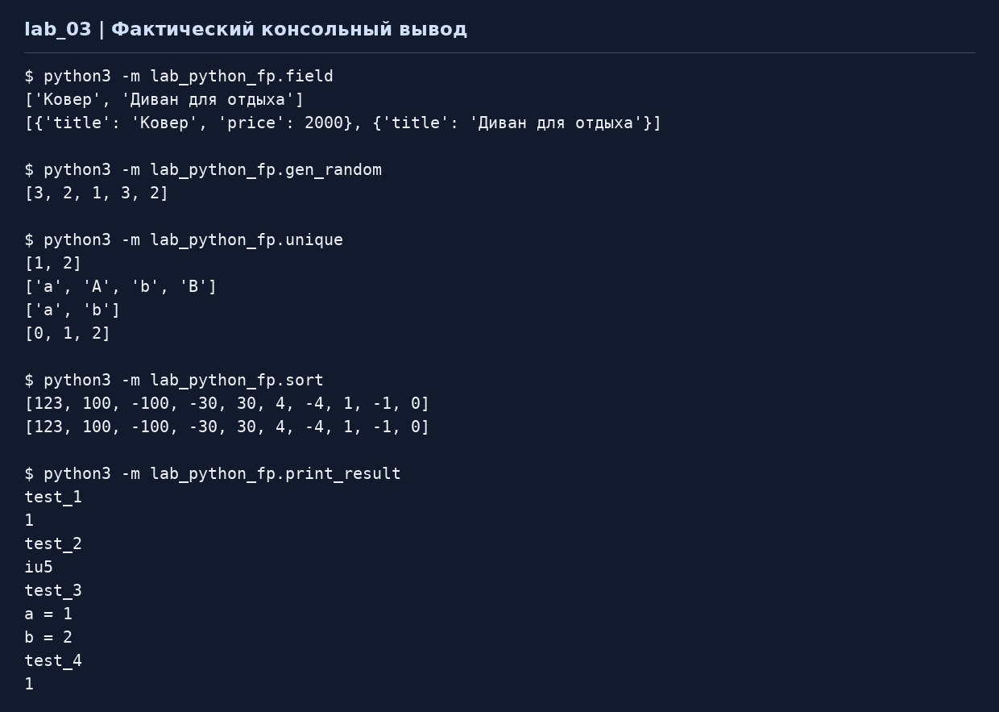
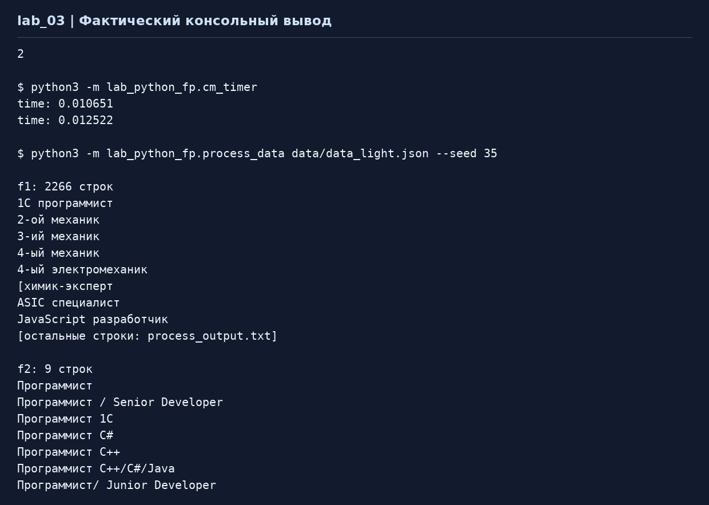
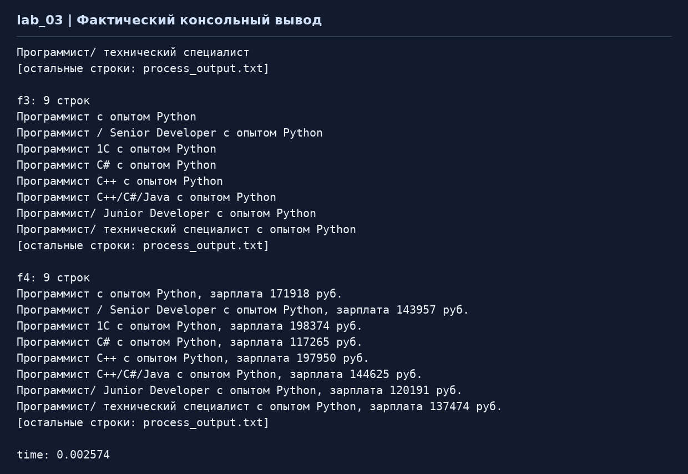

# Лабораторная работа №3

## Функциональные возможности языка Python

**Дисциплина:** Парадигмы и конструкции языков программирования  
**Выполнил:** Рулев К. А.  
**Группа:** ИУ5-35Б  
**Год:** 2026

## Цель

Изучить ленивую обработку последовательностей, итераторы, функции высшего порядка,
декораторы и управление контекстом на Python. Применить эти средства к списку вакансий.

## Задание и состав решения

Работа соответствует лабораторной №3 в [программе ИУ5 2026 года](https://github.com/ugapanyuk/courses_content/wiki/COURSE_PCPL_MAIN_2026).
[Страница заданий](https://github.com/ugapanyuk/BKIT_2022/wiki/lab_python_fp)
содержит исторический номер «3–4». Решены все семь задач, каждая оформлена
отдельным модулем пакета `lab_python_fp`.

Используется Python 3.10 или новее и его стандартная библиотека. Примеры и тесты
выполнены на Python 3.13.5. Для запуска модулей текущим каталогом должен быть
`lab_03`; также поддержан непосредственный запуск каждого файла.

## 1. Генератор field

Выбрать из каждого словаря указанные поля. При одном имени возвращается значение; при нескольких — словарь. Отсутствующие значения и None пропускаются, а 0, False и пустые строки сохраняются. Генератор обрабатывает вход по мере запросов next и не изменяет исходные словари.

### Код field.py

```python
"""Выбор непустых значений полей из последовательности словарей."""


def field(items, *args):
    if not args:
        raise ValueError("Укажите хотя бы одно имя поля")
    for item in items:
        if len(args) == 1:
            value = item.get(args[0])
            if value is not None:
                yield value
        else:
            selected = {key: item[key] for key in args if item.get(key) is not None}
            if selected:
                yield selected


if __name__ == "__main__":
    goods = [
        {"title": "Ковер", "price": 2000, "color": "green"},
        {"title": "Диван для отдыха", "color": "black"},
        {"title": None, "price": None},
    ]
    print(list(field(goods, "title")))
    print(list(field(goods, "title", "price")))

```

## 2. Генератор случайных чисел

Получить заданное число случайных целых в замкнутом диапазоне. Генератор вызывает randint для очередного элемента. Отрицательное количество и обратный диапазон отклоняются. В демонстрации установлен seed 35, чтобы пример можно было повторить.

### Код gen_random.py

```python
"""Ленивый генератор случайных целых с включёнными границами."""

import random


def gen_random(num_count, begin, end):
    if num_count < 0:
        raise ValueError("Количество не может быть отрицательным")
    if begin > end:
        raise ValueError("Минимум не может превышать максимум")
    for _ in range(num_count):
        yield random.randint(begin, end)


if __name__ == "__main__":
    random.seed(35)
    print(list(gen_random(5, 1, 3)))

```

## 3. Итератор Unique

Пропустить повторы, сохранив порядок появления. В множестве запоминаются уже встреченные ключи. При ignore_case=True строковый ключ вычисляется через casefold, но возвращается исходное значение. Конструктор получает настройку через **kwargs; по умолчанию регистр учитывается. Поддержаны список и генератор хешируемых значений. В условии два комментария шаблона перепутаны; реализация следует основному описанию и примеру a/A.

### Код unique.py

```python
"""Итератор уникальных хешируемых элементов с сохранением порядка."""


class Unique:
    def __init__(self, items, **kwargs):
        unknown = kwargs.keys() - {"ignore_case"}
        if unknown:
            raise TypeError(f"Неизвестные параметры: {', '.join(sorted(unknown))}")
        self.ignore_case = kwargs.get("ignore_case", False)
        if not isinstance(self.ignore_case, bool):
            raise TypeError("ignore_case должен иметь тип bool")
        self._items = iter(items)
        self._seen = set()

    def __iter__(self):
        return self

    def __next__(self):
        for item in self._items:
            key = item.casefold() if self.ignore_case and isinstance(item, str) else item
            if key not in self._seen:
                self._seen.add(key)
                return item
        raise StopIteration


if __name__ == "__main__":
    print(list(Unique([1, 1, 1, 2, 2, 2])))
    letters = ["a", "A", "b", "B", "a", "A", "b", "B"]
    print(list(Unique(letters)))
    print(list(Unique(letters, ignore_case=True)))
    print(list(Unique(value % 3 for value in range(8))))

```

## 4. Сортировка по модулю

Отсортировать числа по убыванию абсолютной величины двумя выражениями: с ключом abs и с lambda. sorted не изменяет исходный список и сохраняет взаимный порядок чисел с одинаковым модулем.

### Код sort.py

```python
"""Два способа устойчивой сортировки по убыванию модуля."""

data = [4, -30, 30, 100, -100, 123, 1, 0, -1, -4]


if __name__ == "__main__":
    print(sorted(data, key=abs, reverse=True))
    print(sorted(data, key=lambda value: abs(value), reverse=True))

```

## 5. Декоратор print_result

Вывести имя вызванной функции и её результат, затем вернуть тот же результат вызывающему коду. Списки печатаются по одному элементу на строку, словари — парами ключ = значение. Обёртка принимает *args и **kwargs; wraps сохраняет имя и описание исходной функции.

### Код print_result.py

```python
"""Декоратор печати с сохранением возвращаемого значения и метаданных."""

from functools import wraps


def print_result(function):
    @wraps(function)
    def wrapper(*args, **kwargs):
        result = function(*args, **kwargs)
        print(function.__name__)
        if isinstance(result, dict):
            for key, value in result.items():
                print(f"{key} = {value}")
        elif isinstance(result, list):
            for item in result:
                print(item)
        else:
            print(result)
        return result

    return wrapper


@print_result
def test_1():
    return 1


@print_result
def test_2():
    return "iu5"


@print_result
def test_3():
    return {"a": 1, "b": 2}


@print_result
def test_4():
    return [1, 2]


if __name__ == "__main__":
    test_1()
    test_2()
    test_3()
    test_4()

```

## 6. Два контекстных менеджера

Измерить продолжительность блока по монотонному счётчику perf_counter. cm_timer_1 реализован классом, cm_timer_2 — генератором с contextmanager. Оба печатают время и при нормальном выходе, и при исключении. Исключение не подавляется. Для быстрого примера используется ожидание 0.01 секунды.

### Код cm_timer.py

```python
"""Контекстные менеджеры на основе класса и contextlib."""

from contextlib import contextmanager
from time import perf_counter, sleep


class cm_timer_1:
    def __enter__(self):
        self._started = perf_counter()
        return self

    def __exit__(self, exc_type, exc_value, traceback):
        print(f"time: {perf_counter() - self._started:.6f}")
        return False


@contextmanager
def cm_timer_2():
    started = perf_counter()
    try:
        yield
    finally:
        print(f"time: {perf_counter() - started:.6f}")


if __name__ == "__main__":
    with cm_timer_1():
        sleep(0.01)
    with cm_timer_2():
        sleep(0.01)

```

## 7. Обработка списка вакансий

Прочитать JSON и последовательно выполнить четыре преобразования. f1 извлекает job-name, убирает повторы без учёта регистра и сортирует тем же способом. f2 с помощью filter оставляет названия с префиксом «программист». f3 применяет map и добавляет «с опытом Python». f4 объединяет специальности и сгенерированные зарплаты через zip. Каждая функция имеет одну строку тела; ограничение не более трёх строк для f4 также соблюдено. Декораторы печатают промежуточные результаты, общий таймер измеряет цепочку.

### Код process_data.py

```python
"""Обработка списка вакансий цепочкой функциональных преобразований."""

import argparse
import json
from pathlib import Path
import random

if __package__:
    from .cm_timer import cm_timer_1
    from .field import field
    from .gen_random import gen_random
    from .print_result import print_result
    from .unique import Unique
else:
    from cm_timer import cm_timer_1
    from field import field
    from gen_random import gen_random
    from print_result import print_result
    from unique import Unique


@print_result
def f1(arg):
    return sorted(Unique(field(arg, "job-name"), ignore_case=True), key=str.casefold)


@print_result
def f2(arg):
    return list(filter(lambda title: title.casefold().startswith("программист"), arg))


@print_result
def f3(arg):
    return list(map(lambda title: f"{title} с опытом Python", arg))


@print_result
def f4(arg):
    return [f"{title}, зарплата {salary} руб." for title, salary in zip(arg, gen_random(len(arg), 100000, 200000))]


def main(argv=None):
    parser = argparse.ArgumentParser(description=__doc__)
    parser.add_argument("path", nargs="?", type=Path, default=Path(__file__).resolve().parents[1] / "data" / "data_light.json")
    parser.add_argument("--seed", type=int, help="Начальное значение для воспроизводимых примеров")
    args = parser.parse_args(argv)
    if args.seed is not None:
        random.seed(args.seed)
    try:
        with args.path.open(encoding="utf-8") as stream:
            data = json.load(stream)
    except (OSError, UnicodeError, json.JSONDecodeError) as error:
        parser.error(str(error))
    if not isinstance(data, list) or any(not isinstance(row, dict) for row in data):
        parser.error("Ожидается JSON-массив словарей")
    if any(row.get("job-name") is not None and not isinstance(row["job-name"], str) for row in data):
        parser.error("Поле job-name должно быть строкой или null")
    with cm_timer_1():
        f4(f3(f2(f1(data))))


if __name__ == "__main__":
    main()

```

## Исходные данные

Использован полный [data_light.json из материалов преподавателя](https://github.com/ugapanyuk/BKIT_2021/blob/main/notebooks/fp/files/data_light.json),
включённый в каталог data без изменений. Он содержит 4635 вакансий и занимает
14 232 722 байта. Название вакансии находится в поле job-name.

SHA-256: `a24255855ed619f8e5b8daee0eb614a8c5d8df7e417cf84fa9227ede334b9054`.

После f1 остаются 2266 названий; f2 выбирает 9 названий, f3 и f4 сохраняют это
количество. Сгенерированные суммы от 100000 до 200000 рублей служат учебным
примером и не являются зарплатами из исходных вакансий.

## Результаты запуска

Ниже сохранён фактический вывод. Время зависит от компьютера и нагрузки.
В обработке полного датасета длинные результаты сокращены только в этой
сводке; весь вывод из 2298 строк сохранён в process_output.txt.

```text
$ python3 -m lab_python_fp.field
['Ковер', 'Диван для отдыха']
[{'title': 'Ковер', 'price': 2000}, {'title': 'Диван для отдыха'}]

$ python3 -m lab_python_fp.gen_random
[3, 2, 1, 3, 2]

$ python3 -m lab_python_fp.unique
[1, 2]
['a', 'A', 'b', 'B']
['a', 'b']
[0, 1, 2]

$ python3 -m lab_python_fp.sort
[123, 100, -100, -30, 30, 4, -4, 1, -1, 0]
[123, 100, -100, -30, 30, 4, -4, 1, -1, 0]

$ python3 -m lab_python_fp.print_result
test_1
1
test_2
iu5
test_3
a = 1
b = 2
test_4
1
2

$ python3 -m lab_python_fp.cm_timer
time: 0.010651
time: 0.012522

$ python3 -m lab_python_fp.process_data data/data_light.json --seed 35

f1: 2266 строк
1С программист
2-ой механик
3-ий механик
4-ый механик
4-ый электромеханик
[химик-эксперт
ASIC специалист
JavaScript разработчик
[остальные строки: process_output.txt]

f2: 9 строк
Программист
Программист / Senior Developer
Программист 1С
Программист C#
Программист С++
Программист С++/С#/Java
Программист/ Junior Developer
Программист/ технический специалист
[остальные строки: process_output.txt]

f3: 9 строк
Программист с опытом Python
Программист / Senior Developer с опытом Python
Программист 1С с опытом Python
Программист C# с опытом Python
Программист С++ с опытом Python
Программист С++/С#/Java с опытом Python
Программист/ Junior Developer с опытом Python
Программист/ технический специалист с опытом Python
[остальные строки: process_output.txt]

f4: 9 строк
Программист с опытом Python, зарплата 171918 руб.
Программист / Senior Developer с опытом Python, зарплата 143957 руб.
Программист 1С с опытом Python, зарплата 198374 руб.
Программист C# с опытом Python, зарплата 117265 руб.
Программист С++ с опытом Python, зарплата 197950 руб.
Программист С++/С#/Java с опытом Python, зарплата 144625 руб.
Программист/ Junior Developer с опытом Python, зарплата 120191 руб.
Программист/ технический специалист с опытом Python, зарплата 137474 руб.
[остальные строки: process_output.txt]

time: 0.002574
```

## Автоматическая проверка

Команда: `python3 -m unittest discover -s tests -v`.

Проверено 21 условие: отсутствие/None и ложные значения в field; ленивое
потребление входа; количество и границы случайных значений; сохранение первого
написания строк; работа Unique с генератором; возвращаемый объект, аргументы и
метаданные декоратора; оба таймера при нормальном выходе и ошибке; сортировка;
полная цепочка обработки на контролируемом наборе данных; пустой набор.

Фактический результат:

```text
test_lazy_consumption (test_lab.FieldTests.test_lazy_consumption) ... ok
test_multiple_fields_and_source_unchanged (test_lab.FieldTests.test_multiple_fields_and_source_unchanged) ... ok
test_no_fields (test_lab.FieldTests.test_no_fields) ... ok
test_single_field_skips_missing_and_none_but_keeps_falsy (test_lab.FieldTests.test_single_field_skips_missing_and_none_but_keeps_falsy) ... ok
test_list_is_printed_in_column_and_not_copied (test_lab.PrintingTests.test_list_is_printed_in_column_and_not_copied) ... ok
test_print_return_metadata_arguments (test_lab.PrintingTests.test_print_return_metadata_arguments) ... ok
test_scalar_and_none (test_lab.PrintingTests.test_scalar_and_none) ... ok
test_empty_pipeline (test_lab.ProcessingTests.test_empty_pipeline) ... ok
test_pipeline_preserves_first_case_and_transforms (test_lab.ProcessingTests.test_pipeline_preserves_first_case_and_transforms) ... ok
test_sort_demo_both_versions (test_lab.ProcessingTests.test_sort_demo_both_versions) ... ok
test_count_and_bounds (test_lab.RandomTests.test_count_and_bounds) ... ok
test_inclusive_equal_endpoints (test_lab.RandomTests.test_inclusive_equal_endpoints) ... ok
test_invalid_bounds_and_count (test_lab.RandomTests.test_invalid_bounds_and_count) ... ok
test_random_calls_are_lazy (test_lab.RandomTests.test_random_calls_are_lazy) ... ok
test_both_timers_measure_interval (test_lab.TimerTests.test_both_timers_measure_interval) ... ok
test_exceptions_propagate_and_elapsed_time_is_printed (test_lab.TimerTests.test_exceptions_propagate_and_elapsed_time_is_printed) ... ok
test_bool_option_validation (test_lab.UniqueTests.test_bool_option_validation) ... ok
test_generator_and_iterator_protocol (test_lab.UniqueTests.test_generator_and_iterator_protocol) ... ok
test_lazy_input (test_lab.UniqueTests.test_lazy_input) ... ok
test_order_and_case_modes (test_lab.UniqueTests.test_order_and_case_modes) ... ok
test_original_string_is_returned (test_lab.UniqueTests.test_original_string_is_returned) ... ok

----------------------------------------------------------------------
Ran 21 tests in 0.016s

OK
```

## Вывод

Реализован пакет из семи модулей. Генераторы field и gen_random и итератор Unique
позволяют получать элементы по требованию. Преобразования вакансий объединены
в цепочку функций, а печать и измерение времени вынесены в повторно используемые
декоратор и контекстные менеджеры. Все 21 тест прошли; полный учебный датасет
обработан успешно, все модули запускаются отдельно.

## Экранные формы фактических результатов

Ниже визуализирован фактический консольный вывод из `output.txt`. Полный текст сохранён рядом с исходным кодом. Длинные строки в PDF перенесены для удобства чтения.







