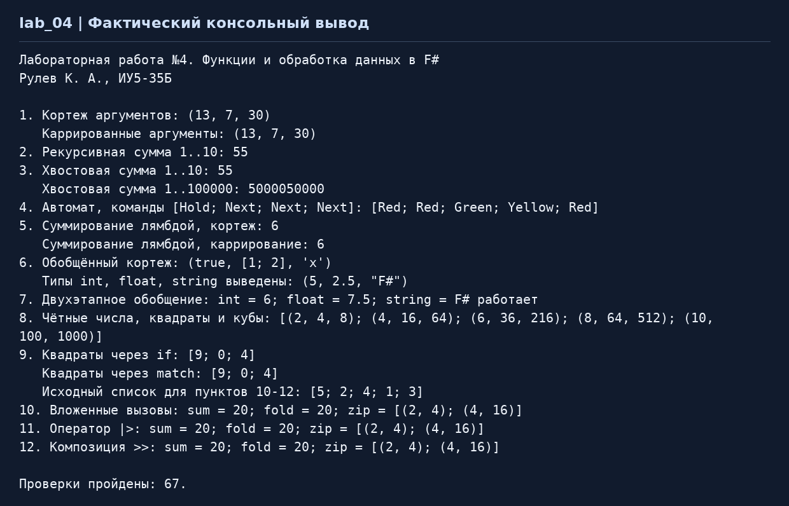

# Лабораторная работа №4

## Титульный лист

МГТУ им. Н. Э. Баумана  
Кафедра ИУ5  
Дисциплина: «Парадигмы и конструкции языков программирования»  
Тема: «Функции и обработка данных в F#»  
Выполнил: Рулев К. А.  
Группа: ИУ5-35Б  
Москва, 2026

## Цель работы

Изучить объявление функций, каррирование, рекурсию, обобщения и преобразования списков в F#. Сравнить запись одного вычисления через вложенные вызовы, оператор потока и композицию функций.

## Задание

Реализовать консольное приложение с двенадцатью группами примеров:

1. Функции с аргументами-кортежами и каррированными аргументами, возвращающие кортеж.
2. Рекурсивное вычисление суммы чисел диапазона.
3. Хвостовой вариант этой рекурсии.
4. Автомат с тремя состояниями на взаимно-рекурсивных функциях.
5. Передачу трёх целых чисел и суммирующей лямбды в двух формах.
6. Обобщённую тройку и вывод типов `int`, `float`, `string` из операций.
7. Обобщённое сложение с последующей специализацией для трёх типов.
8. Списковое включение: чётные числа от 1 до 10, их квадраты и кубы.
9. Два рекурсивных преобразования списка через `Head` и `Tail`.
10. Комбинации операций над списком с окончанием `sum`, `fold`, `zip`.
11. Те же комбинации через `|>`.
12. Те же комбинации через `>>`.

Источник: [официальное условие лабораторной №4](https://github.com/ugapanyuk/courses_content/wiki/F_sharp_base), опубликованное в [программе ИУ5 осени 2026 года](https://github.com/ugapanyuk/courses_content/wiki/COURSE_PCPL_MAIN_2026).

## Средства разработки и запуск

Использован F# в консольном проекте с целевой платформой .NET 10. Проверка выполнена на macOS arm64 с .NET SDK 10.0.404. Дополнительные библиотеки тестирования не используются. В проекте включён режим, в котором предупреждения компилятора считаются ошибками.

Из каталога лабораторной работы:

```bash
dotnet build
dotnet run
dotnet run -- --test
dotnet run -- --all
```

## Описание решения

### Функции, каррирование и рекурсия

`tupledOperations` получает пару чисел одним аргументом. `curriedOperations` получает их последовательно и допускает частичное применение. Обе функции возвращают сумму, разность и произведение.

`sumRange` прибавляет текущее число к результату рекурсивного вызова. `sumRangeTail` переносит промежуточную сумму в аккумулятор: после вызова больше нет вычислений. Пустой диапазон даёт ноль; отрицательные границы поддерживаются. Сумма хранится в `int64`. Проверка диапазона 1..100000 даёт 5000050000, то есть результат корректно выходит за пределы `int`.

### Три состояния автомата

Автомат моделирует светофор. Начальное состояние - `Red`. Команда `Next` выполняет переход `Red -> Green -> Yellow -> Red`, команда `Hold` сохраняет состояние. Каждому состоянию соответствует отдельная локальная функция; три функции объявлены через `let rec ... and ... and ...`. Результат содержит начальное состояние и состояние после каждой команды. История накапливается добавлением в начало и один раз разворачивается после обработки всех команд.

### Функции высшего порядка и типы

`applyTupled` и `applyCurried` вызывают переданное лямбда-выражение для трёх чисел. В демонстрации лямбда складывает аргументы. `makeTriple` сохраняет независимые обобщённые типы трёх аргументов. В `inferredTriple` операции с литералами `0`, `0.0`, `""` ограничивают типы до `int`, `float`, `string` без аннотаций параметров.

Двухэтапное обобщение реализовано через `inline addThree`: сначала определяется общая операция сложения, затем создаются три конкретные функции для `int`, `float`, `string`. Для строк оператор `+` означает конкатенацию.

### Работа со списками

`evenPowers` использует списковое включение. `squaresIf` проверяет пустоту через `if`, а `squaresMatch` использует сопоставление на уровне функции. Обращения к `Head` и `Tail` происходят только в ветви непустого списка.

В первой комбинации для пунктов 10-12 список преобразуется в квадраты, фильтруются чётные результаты, выполняются сортировка и `List.sum`. Вторая комбинация отличается последней операцией: `List.fold (+) 0`, поэтому результат совпадает. Третья комбинация выбирает и сортирует чётные исходные числа, а затем соединяет их с квадратами через `List.zip`. Длины соединяемых списков одинаковы по построению.

Все три комбинации записаны трижды: вложенные вызовы, поток `|>` и композиция `>>`. Для списка `[5; 2; 4; 1; 3]` сумма и свёртка дают 20, а соединение даёт `[(2, 4); (4, 16)]` во всех вариантах.

### Ограничения учебных примеров

Обычная рекурсия предназначена для небольших диапазонов. Для больших диапазонов предусмотрен хвостовой вариант. Квадраты, кубы и примеры сложения `int` используют обычную ограниченную целочисленную арифметику и небольшие демонстрационные значения. Программа не заявляет поддержку произвольно больших чисел.

## Полный текст программы

### Lab04.fsproj

```xml
<Project Sdk="Microsoft.NET.Sdk">
  <PropertyGroup>
    <OutputType>Exe</OutputType>
    <TargetFramework>net10.0</TargetFramework>
    <TreatWarningsAsErrors>true</TreatWarningsAsErrors>
  </PropertyGroup>
  <ItemGroup>
    <Compile Include="LabFunctions.fs" />
    <Compile Include="Tests.fs" />
    <Compile Include="Program.fs" />
  </ItemGroup>
</Project>
```

### LabFunctions.fs

```fsharp
module LabFunctions

// 1. Аргументы-кортеж и каррированные аргументы; результат - кортеж.
let tupledOperations (a: int, b: int) = (a + b, a - b, a * b)
let curriedOperations (a: int) (b: int) = (a + b, a - b, a * b)

// 2. После рекурсивного вызова ещё выполняется сложение.
let rec sumRange first last =
    if first > last then 0L
    elif first = last then int64 first
    else int64 first + sumRange (first + 1) last

// 3. Аккумулятор переносит промежуточную сумму в следующий вызов.
let sumRangeTail first last =
    let rec loop current total =
        if current > last then total
        else
            let nextTotal = total + int64 current
            if current = last then nextTotal
            else loop (current + 1) nextTotal
    loop first 0L

// 4. Светофор: красный -> зелёный -> жёлтый -> красный.
type Light = Red | Green | Yellow
type Signal = Next | Hold

let runTrafficLight signals =
    let rec red remaining history =
        match remaining with
        | [] -> List.rev history
        | Hold :: rest -> red rest (Red :: history)
        | Next :: rest -> green rest (Green :: history)
    and green remaining history =
        match remaining with
        | [] -> List.rev history
        | Hold :: rest -> green rest (Green :: history)
        | Next :: rest -> yellow rest (Yellow :: history)
    and yellow remaining history =
        match remaining with
        | [] -> List.rev history
        | Hold :: rest -> yellow rest (Yellow :: history)
        | Next :: rest -> red rest (Red :: history)
    red signals [Red]

// 5. Функция суммирования передаётся как значение.
let applyTupled (a: int, b: int, c: int, operation) = operation a b c
let applyCurried (a: int) (b: int) (c: int) operation = operation a b c

// 6. В первом случае три независимых обобщённых типа.
let makeTriple a b c = (a, b, c)

// Без аннотаций: операнды задают int, float и string соответственно.
let inferredTriple a b c = (a + 0, b + 0.0, c + "")

// 7. Этап 1: inline-обобщение по поддерживаемому оператору (+).
let inline addThree a b c = a + b + c

// Этап 2: конкретизация обобщённой функции для трёх типов.
let sumThreeInts: int -> int -> int -> int = addThree
let sumThreeFloats: float -> float -> float -> float = addThree
let sumThreeStrings: string -> string -> string -> string = addThree

// 8. Списковое включение с фильтрацией чётных чисел.
let evenPowers =
    [ for value in 1 .. 10 do
          if value % 2 = 0 then
              yield (value, value * value, value * value * value) ]

// 9. Head и Tail доступны только после проверки непустого списка.
let rec squaresIf (values: int list) =
    if values.IsEmpty then []
    else values.Head * values.Head :: squaresIf values.Tail

let rec squaresMatch = function
    | [] -> []
    | (values: int list) ->
        values.Head * values.Head :: squaresMatch values.Tail

// 10. Обычные вложенные вызовы: map -> filter -> sort -> агрегирование.
let sumOrdinary values =
    List.sum (List.sort (List.filter (fun x -> x % 2 = 0)
        (List.map (fun x -> x * x) values)))

let foldOrdinary values =
    List.fold (+) 0 (List.sort (List.filter (fun x -> x % 2 = 0)
        (List.map (fun x -> x * x) values)))

let zipOrdinary values =
    let even = List.sort (List.filter (fun x -> x % 2 = 0) values)
    List.zip even (List.map (fun x -> x * x) even)

// 11. Те же три вычисления с оператором потока (|>).
let sumPipeline values =
    values
    |> List.map (fun x -> x * x)
    |> List.filter (fun x -> x % 2 = 0)
    |> List.sort
    |> List.sum

let foldPipeline values =
    values
    |> List.map (fun x -> x * x)
    |> List.filter (fun x -> x % 2 = 0)
    |> List.sort
    |> List.fold (+) 0

let zipPipeline values =
    let even = values |> List.filter (fun x -> x % 2 = 0) |> List.sort
    even |> List.map (fun x -> x * x) |> List.zip even

// 12. Композиция (>>) строит функцию до передачи ей списка.
let sumComposition =
    List.map (fun x -> x * x)
    >> List.filter (fun x -> x % 2 = 0)
    >> List.sort
    >> List.sum

let foldComposition =
    List.map (fun x -> x * x)
    >> List.filter (fun x -> x % 2 = 0)
    >> List.sort
    >> List.fold (+) 0

let zipComposition =
    List.filter (fun x -> x % 2 = 0)
    >> List.sort
    >> (fun even -> (List.map (fun x -> x * x) >> List.zip even) even)
```

### Tests.fs

```fsharp
module Tests

open LabFunctions

let run () =
    let mutable checks = 0
    let equal label expected actual =
        checks <- checks + 1
        if expected <> actual then
            failwithf "%s: ожидалось %A, получено %A" label expected actual

    equal "Кортеж аргументов" (13, 7, 30) (tupledOperations (10, 3))
    equal "Каррированные аргументы" (13, 7, 30) (curriedOperations 10 3)
    equal "Частичное применение" (13, 7, 30) ((curriedOperations 10) 3)

    for first, last, expected in [1, 10, 55L; -3, 3, 0L; 5, 5, 5L; 3, 1, 0L] do
        equal "Обычная рекурсия" expected (sumRange first last)
        equal "Хвостовая рекурсия" expected (sumRangeTail first last)
    equal "Большой диапазон и int64" 5000050000L (sumRangeTail 1 100000)
    equal "Верхняя граница int" 2147483647L (sumRangeTail System.Int32.MaxValue System.Int32.MaxValue)
    equal "Пустая последовательность команд" [Red] (runTrafficLight [])
    equal "Цикл автомата" [Red; Green; Yellow; Red] (runTrafficLight [Next; Next; Next])
    equal "Удержание в каждом состоянии"
        [Red; Red; Green; Green; Yellow; Yellow; Red]
        (runTrafficLight [Hold; Next; Hold; Next; Hold; Next])

    equal "Лямбда, кортеж" 6 (applyTupled (1, 2, 3, fun a b c -> a + b + c))
    equal "Лямбда, каррирование" 6 (applyCurried 1 2 3 (fun a b c -> a + b + c))
    equal "Переданная операция действительно вызывается" 14 (applyCurried 2 3 4 (fun a b c -> a + b * c))
    equal "Разные обобщённые типы" (true, [1; 2], 'x') (makeTriple true [1; 2] 'x')
    equal "Выведение int, float, string" (5, 2.5, "F#") (inferredTriple 5 2.5 "F#")
    equal "Обобщённое сложение int" 6 (sumThreeInts 1 2 3)
    equal "Обобщённое сложение float" 7.5 (sumThreeFloats 1.5 2.5 3.5)
    equal "Обобщённое сложение string" "F# работает" (sumThreeStrings "F#" " " "работает")
    equal "Списковое включение"
        [(2, 4, 8); (4, 16, 64); (6, 36, 216); (8, 64, 512); (10, 100, 1000)] evenPowers

    for values, expected in [[], []; [-3; 0; 2], [9; 0; 4]; [5], [25]] do
        equal "Head/Tail, if" expected (squaresIf values)
        equal "Head/Tail, match" expected (squaresMatch values)

    for values, expectedSum, expectedZip in
        [ [5; 2; 4; 1; 3], 20, [(2, 4); (4, 16)]
          [], 0, []
          [1; 3; 5], 0, []
          [-2; 4; 0; 2; -2], 28, [(-2, 4); (-2, 4); (0, 0); (2, 4); (4, 16)] ] do
        for calculate in [sumOrdinary; foldOrdinary; sumPipeline; foldPipeline; sumComposition; foldComposition] do
            equal "Агрегирование и fold во всех стилях" expectedSum (calculate values)
        for calculate in [zipOrdinary; zipPipeline; zipComposition] do
            equal "zip во всех стилях" expectedZip (calculate values)

    printfn "Проверки пройдены: %d." checks
    checks
```

### Program.fs

```fsharp
module Program

open LabFunctions

let demonstrate () =
    printfn "Лабораторная работа №4. Функции и обработка данных в F#"
    printfn "Рулев К. А., ИУ5-35Б"
    printfn "\n1. Кортеж аргументов: %A" (tupledOperations (10, 3))
    printfn "   Каррированные аргументы: %A" (curriedOperations 10 3)
    printfn "2. Рекурсивная сумма 1..10: %d" (sumRange 1 10)
    printfn "3. Хвостовая сумма 1..10: %d" (sumRangeTail 1 10)
    printfn "   Хвостовая сумма 1..100000: %d" (sumRangeTail 1 100000)
    printfn "4. Автомат, команды [Hold; Next; Next; Next]: %A"
        (runTrafficLight [Hold; Next; Next; Next])
    printfn "5. Суммирование лямбдой, кортеж: %d"
        (applyTupled (1, 2, 3, fun a b c -> a + b + c))
    printfn "   Суммирование лямбдой, каррирование: %d"
        (applyCurried 1 2 3 (fun a b c -> a + b + c))
    printfn "6. Обобщённый кортеж: %A" (makeTriple true [1; 2] 'x')
    printfn "   Типы int, float, string выведены: %A" (inferredTriple 5 2.5 "F#")
    printfn "7. Двухэтапное обобщение: int = %d; float = %.1f; string = %s"
        (sumThreeInts 1 2 3)
        (sumThreeFloats 1.5 2.5 3.5)
        (sumThreeStrings "F#" " " "работает")
    printfn "8. Чётные числа, квадраты и кубы: %A" evenPowers
    printfn "9. Квадраты через if: %A" (squaresIf [-3; 0; 2])
    printfn "   Квадраты через match: %A" (squaresMatch [-3; 0; 2])
    let values = [5; 2; 4; 1; 3]
    printfn "   Исходный список для пунктов 10-12: %A" values
    printfn "10. Вложенные вызовы: sum = %d; fold = %d; zip = %A"
        (sumOrdinary values) (foldOrdinary values) (zipOrdinary values)
    printfn "11. Оператор |>: sum = %d; fold = %d; zip = %A"
        (sumPipeline values) (foldPipeline values) (zipPipeline values)
    printfn "12. Композиция >>: sum = %d; fold = %d; zip = %A"
        (sumComposition values) (foldComposition values) (zipComposition values)

[<EntryPoint>]
let main argv =
    match argv with
    | [||] -> demonstrate (); 0
    | [|"--test"|] -> Tests.run () |> ignore; 0
    | [|"--all"|] -> demonstrate (); printfn ""; Tests.run () |> ignore; 0
    | _ ->
        eprintfn "Использование: dotnet run -- [--test|--all]"
        2
```

## Результаты выполнения

Ниже приведён фактический вывод `dotnet run -- --all`. Тот же вывод сохранён в файле `output.txt`.

```text
Лабораторная работа №4. Функции и обработка данных в F#
Рулев К. А., ИУ5-35Б

1. Кортеж аргументов: (13, 7, 30)
   Каррированные аргументы: (13, 7, 30)
2. Рекурсивная сумма 1..10: 55
3. Хвостовая сумма 1..10: 55
   Хвостовая сумма 1..100000: 5000050000
4. Автомат, команды [Hold; Next; Next; Next]: [Red; Red; Green; Yellow; Red]
5. Суммирование лямбдой, кортеж: 6
   Суммирование лямбдой, каррирование: 6
6. Обобщённый кортеж: (true, [1; 2], 'x')
   Типы int, float, string выведены: (5, 2.5, "F#")
7. Двухэтапное обобщение: int = 6; float = 7.5; string = F# работает
8. Чётные числа, квадраты и кубы: [(2, 4, 8); (4, 16, 64); (6, 36, 216); (8, 64, 512); (10, 100, 1000)]
9. Квадраты через if: [9; 0; 4]
   Квадраты через match: [9; 0; 4]
   Исходный список для пунктов 10-12: [5; 2; 4; 1; 3]
10. Вложенные вызовы: sum = 20; fold = 20; zip = [(2, 4); (4, 16)]
11. Оператор |>: sum = 20; fold = 20; zip = [(2, 4); (4, 16)]
12. Композиция >>: sum = 20; fold = 20; zip = [(2, 4); (4, 16)]

Проверки пройдены: 67.
```

## Проверка корректности

Встроенный набор выполнил 67 проверок. Проверены:

- равенство кортежного и каррированного вариантов;
- пустой, отрицательный и одноэлементный диапазоны, а также 1..100000;
- полный цикл автомата и удержание во всех трёх состояниях;
- фактическое применение переданной функции;
- разные обобщённые типы и три специализации сложения;
- пустые списки, отрицательные числа и повторяющиеся элементы;
- равенство `sum` и `fold`, а также совпадение всех трёх способов записи;
- соответствие элементов и квадратов при `zip`.

Сборка и запуск завершились с кодом 0. Дополнительно проверен неизвестный аргумент запуска: программа выдаёт подсказку и код завершения 2.

## Вывод

Все двенадцать пунктов реализованы в одном консольном приложении. Каррирование позволяет частичное применение, хвостовая рекурсия переносит состояние вычисления в аккумулятор, а взаимная рекурсия непосредственно описывает переходы автомата. Обобщения отделяют алгоритм от конкретных типов. Вложенные вызовы, поток и композиция выполняют одинаковые преобразования списков; это подтверждено автоматическими проверками.

## Экранные формы фактических результатов

Ниже визуализирован фактический консольный вывод из `output.txt`. Полный текст сохранён рядом с исходным кодом. Длинные строки в PDF перенесены для удобства чтения.



